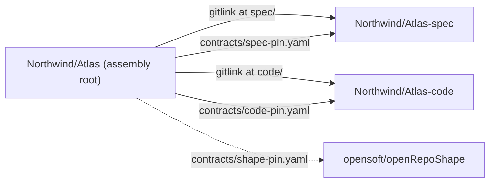

# openRepoShape

**Status: ratified standard.** The mechanics of a project that spans several
repositories: what they are called, how they are pinned to each other, how one
clone brings the whole project down, and what an AI assistant does when a human
says "scaffold a new project with this shape".

GitHub has no folder that groups repositories, so a project spanning several of
them is held together by convention or by nothing. This repository is the
convention, as data and as running code.

Ruled by **Brett Heap on 2026-09-02**: the name `openRepoShape`, PUBLIC
visibility, Apache-2.0; and that the ASSEMBLY leg **is** the per-project root
repository — the one an engineer clones. The doctrine it serves was ratified
by Brett Heap on 2026-09-02 and lives in `opensoft/openxFactory` at
`docs/project-repo-schema.md`, which is what a project's `project.yaml`
records as the `reference:` the election followed; a project elected before
that date recorded the staged fragment's path, and that is a valid reference
for it. `scaffold-project.py` and `adopt-project.py` pick that default FROM
`--elected-on` — the staged path for an election dated before 2026-09-02, the
ratified one from that day on — so a back-dated project does not claim its
election followed a document that did not yet exist; `--reference` overrides
both.

> [!IMPORTANT]
> **The shape is elective and confers nothing.** Electing it changes no gate, no
> floor, no grant and no clearance eligibility. A one-repository project and a
> three-repository project are reviewed identically, because the authority
> travels in the grants rather than in the layout. Review lanes and
> wallet-carried authority are OVERLAYS an org adds later; a project with no
> overlays is fully conformant.
>
> **The Triad is the PREFERRED shape, and still confers nothing.** The Triad is
> this shape — an assembly root with a spec leg and a code leg; "three-leg" and
> "three-repository project" mean the same, and no machine key changed. Ruled by
> **Brett Heap on 2026-10-06**: *"ratify 1249 as recommended"*, ratifying
> openxFactory's `prefer-triad-project-shape`. It is the recommended default for
> a new project and the recommended target for an existing single repository.
> Preferred is not required: electing it stays a person's decision per project,
> converting stays `adopt-project.py` run by that person, and a project kept in
> one repository is reviewed identically and owes no declaration.

**Where the preference is said, and where it is not.** At the start of work,
once, in a line or two, and never as a stop: `scaffold-project.py`'s plan names
the Triad as what it creates, `adopt-project.py plan` and `check` say it about
the repository they read, and `shape-doctor.py` gives a single repository one
`advisory` row. None blocks, converts, writes or changes an exit status on its
account, and nothing records that it was given. It is never a review input: no
review lane, required check, validator, floor, council or merge gate reads the
shape, and a check built on the doctor's `NOT A SHAPE ROOT` is defective. It is
silent in an elected Triad's assembly root, a leg clone (which is told to work
from its root instead), a family holder, a `<user>-wip` workspace repository
and a repository carrying `single-repository.yaml`. Every other repository —
an aggregation, a configuration repository, a vendored fork — hears it, because
no class is guessed.

**`single-repository.yaml` is OPTIONAL and never owed.** A project that has
decided to stay a single repository may say so once, at its root, and stop
hearing the advisory: `schema_version: 1`, `kind: single-repository-record`,
`decided_by`, `decided_on`, `reason` and an optional `revisit_on`. Its schema
is `contracts/single-repository-record.yaml` and its template
`templates/single-repository/single-repository.yaml`; nothing here writes one
for anybody. It confers nothing and the advisory is its only reader. `kind:`
decides: one that does not parse, or declares another kind, silences nothing
and is reported beside the advisory, and nothing fails on its account.

- [Starting a project in a new organisation](#starting-a-project-in-a-new-organisation)
  - [Quick start for a first-time user](#quick-start-for-a-first-time-user)
- [The three legs](#the-three-legs)
- [Adopting an existing repository](#adopting-an-existing-repository)
- [Families: a holder for projects that ship separately](#families-a-holder-for-projects-that-ship-separately)
- [The double pin, and the lockstep invariant](#the-double-pin-and-the-lockstep-invariant)
- [Bootstrap is COPIED into the project, not fetched](#bootstrap-is-copied-into-the-project-not-fetched)
- [Keeping a project's shape current](#keeping-a-projects-shape-current)
  - [Is this repository compliant? `openRepoShape --doctor`](#is-this-repository-compliant-openreposhape---doctor)
- [Carrying in-flight work to another workstation](#carrying-in-flight-work-to-another-workstation)
  - [`park <Name>` and `resume <Name>`, from anywhere](#park-name-and-resume-name-from-anywhere)
  - [Who implements it, and what the record is](#who-implements-it-and-what-the-record-is)
- [The degrade rule](#the-degrade-rule)
- [Layout of this repository](#layout-of-this-repository)
- [Licence](#licence)

## Starting a project in a new organisation

### Quick start for a first-time user

**Linux:** run the four steps below in your own shell.

<details>
<summary><b>macOS</b></summary>

**macOS:** the same four steps, once the machine has what they need. The Xcode
Command Line Tools supply `git`, `make` and a `python3` — install them with
`xcode-select --install`, or type `git` once on a fresh Mac and the installer
offers itself; step 4 opens with a preflight that prints the `python3` it found
and refuses anything below 3.9. If it refuses the one the Tools supplied — older
macOS shipped 3.8 — install a newer one from <https://www.python.org/downloads/>
or with `brew install python`, and the preflight will find it first on `PATH`.
`gh` comes from Homebrew, which is its own install if `brew` is absent
(<https://brew.sh>): on Apple Silicon Homebrew lives in `/opt/homebrew`, which
is on no `PATH` by default, and its installer finishes by printing the line that
puts it there — run that line, or the next shell cannot find `brew`. Then `brew
install gh`, and `brew install git-filter-repo` only if you are ADOPTING an
existing repository rather than scaffolding a new one. The stock `/bin/bash` is
3.2 and is enough: `setup.sh`, `install.sh` and the `openRepoShape` command are
written to use no syntax newer than that, though no CI run, on Linux or in Git
Bash on Windows, checks them against bash 3.2. That the login shell is zsh
changes nothing — all three entry points are run under `bash` explicitly.

</details>

<details>
<summary><b>Windows, natively</b></summary>

**Windows, natively.** No WSL2. Install Python 3.9 or newer from
<https://www.python.org/downloads/>, ticking *Add python.exe to PATH* — its
own checkbox, and a different one from *py launcher*, which the installer
ticks for you; `git` from <https://git-scm.com/downloads>; and `gh` with
`winget install --id GitHub.cli -e`. Then `gh auth login`, exactly as in
step 2 below. Make one machine setting first:

```powershell
git config --global core.autocrlf false
```

The git-for-Windows installer offers `true`, which rewrites every checked-out
file's line endings. A scaffolded project records a sha256 per copied file in
its own `contracts/shape-pin.yaml`, so a CRLF checkout reports drift in files
nobody edited. The clone `setup-project.py` makes is configured correctly
whatever the machine says; the global setting is for every clone after it.

Then `pipx install openreposhape` (where `pipx` is missing: `python -m pip
install --user pipx`, then `python -m pipx ensurepath` and a new terminal):
step 3 says what it places, and step 4 runs it. Or, installing nothing, two
commands, run in the directory the new project should land in:

```powershell
Invoke-WebRequest https://raw.githubusercontent.com/opensoft/openRepoShape/main/setup-project.py -OutFile setup-project.py
py setup-project.py <Project> --org <your-org>
```

`python setup-project.py <Project> --org <your-org>` is the same command on a
machine with no `py`: Microsoft Store Python installs `python`, no launcher.
Two commands rather than one pipe, on purpose. Windows PowerShell 5.1 — still
the default shell on a stock install — re-encodes piped text as ASCII by
default (that is its `$OutputEncoding`), and writes UTF-16 when `>` redirects
to a file, so no byte above 0x7F survives either route and a script sent down
one is not the script that arrives; and a script arriving on stdin leaves it
exhausted, so it cannot ask for the one `yes` before three repositories exist
and refuses. Downloading the file first leaves stdin on your terminal.

`setup-project.py` is the flow itself, and `setup.sh` a shim over it: the same
preflight, the same naming check, the same plan, the same one `yes`, the same
self-bootstrap outside a checkout. It never needs `make` and never looks for a
`python3` — it runs the interpreter that started it. That two-liner is the
Windows way in that installs nothing; pipx's `openRepoShape` runs the same flow.
Git Bash runs step 3's bash command and its one line, tested in CI but for a
typed `yes`, which its preflight cannot take there. Printed commands are quoted
for a POSIX shell, so paste them into Git Bash. Only `shape-doctor.py`'s lines,
`setup-project.py`'s family lines and `family.py`'s `NEXT`, `switch -c`, `add`,
`cd`, `git rm -r --cached` and `bump` lines are quoted for the shell they are
printed in, PowerShell or Git Bash, on Windows.
Off Windows and in Git Bash, a path `shape-doctor.py` cannot print as itself is
written `$'…'`: bash, zsh and ksh read that; dash (`/bin/sh` on Debian and
Ubuntu) does not.

</details>

<details>
<summary><b>Windows via WSL2</b></summary>

**Windows via WSL2** runs every bash entry point in Linux itself: `wsl
--install` from an administrator PowerShell, reboot, open the Ubuntu app, and
run the four steps below INSIDE the WSL shell.

</details>

> [!NOTE]
> **The tool offers the rest.** The four steps below are the reference — what
> each platform needs, and how to install it by hand. You do not have to: step 4
> opens with a preflight that names what is missing and, for `gh`, its login and
> its credential helper, prints the command for THIS machine and asks once —
> `Type yes to continue:`, the same words it asks everything else with — then
> runs it and carries on. The preflight installs nothing without that typed
> `yes`; `--yes` does not answer it, and with no terminal attached there is no
> offer at all. Homebrew is the one install never run for you: on a Mac without
> `brew` the preflight names <https://brew.sh> and stops there. To check a
> machine and stop, creating nothing, run `openRepoShape --preflight` —
> `py setup-project.py --preflight` on Windows — which exits 0 when everything
> is present and 1 when it is not (the bash `openRepoShape --preflight` exits
> 2 when `git` or a Python 3.9 or newer is missing).

**1. Install the GitHub CLI**, `gh`. The official instructions are at
<https://cli.github.com/> (and <https://github.com/cli/cli#installation>):

```sh
brew install gh    # macOS, or Linux with Homebrew
```

Debian, Ubuntu, or Windows under WSL2 (WSL2's Ubuntu takes the same command):

```sh
(type -p wget >/dev/null || (sudo apt update && sudo apt install wget -y)) \
	&& sudo mkdir -p -m 755 /etc/apt/keyrings \
	&& out=$(mktemp) && wget -nv -O$out https://cli.github.com/packages/githubcli-archive-keyring.gpg \
	&& cat $out | sudo tee /etc/apt/keyrings/githubcli-archive-keyring.gpg > /dev/null \
	&& sudo chmod go+r /etc/apt/keyrings/githubcli-archive-keyring.gpg \
	&& sudo mkdir -p -m 755 /etc/apt/sources.list.d \
	&& echo "deb [arch=$(dpkg --print-architecture) signed-by=/etc/apt/keyrings/githubcli-archive-keyring.gpg] https://cli.github.com/packages stable main" | sudo tee /etc/apt/sources.list.d/github-cli.list > /dev/null \
	&& sudo apt update \
	&& sudo apt install gh -y
```

Fedora (DNF5):

```sh
sudo dnf install dnf5-plugins
sudo dnf config-manager addrepo --from-repofile=https://cli.github.com/packages/rpm/gh-cli.repo
sudo dnf install gh
```

`git` and Python 3.9 or newer are needed too (see Requirements below). Ubuntu
under WSL2 ships both, so there `gh` is the only install; step 4 opens with a
preflight that names anything missing and where to get it. `git` itself comes
from `xcode-select --install` on macOS, `sudo apt-get install -y git` on Debian
and Ubuntu, `sudo dnf install -y git` on Fedora and `winget install --id Git.Git
-e` on Windows — the same commands `setup-project.py --preflight` offers to run.

**2. Log in.** `gh auth login`, as the account that will own the act — a
member of the organisation who can create repositories there. Accept the
offer to configure git's credential helper, or run `gh auth setup-git`: the
first commits go up with a plain `git push` over HTTPS, and without it the
three repositories are created and the push fails.

**3. Install the `openRepoShape` command**, once, in one line:

```sh
curl -fsSL https://github.com/opensoft/openRepoShape/releases/latest/download/install.sh | bash
```

`install.sh`, attached to every release, installs the newest with no `gh` and no
login. Its command is PINNED to the release tag, recorded in `openRepoShape.ref`
beside it: `setup.sh` and the standard are fetched at that tag, not at main. It
installs `git-filter-repo` with `pipx`, or `uv`, where it can, or prints the
command, runs `openRepoShape --preflight`, and says last if the machine is ready
to adopt or only to scaffold. It never runs `sudo` itself; the preflight offers
what is missing, each behind a typed `yes` at your terminal; in Git Bash it can
take none. `| bash -s -- v1.0.1` names a release; the same line again upgrades.

By hand, the same command at main, which records no ref and follows main:

```sh
gh api repos/opensoft/openRepoShape/contents/openRepoShape \
    -H 'Accept: application/vnd.github.raw' | bash -s -- --install
```

or, where raw downloads are not blocked, the same bytes over HTTPS:

```sh
curl -fsSL https://raw.githubusercontent.com/opensoft/openRepoShape/main/openRepoShape \
    | bash -s -- --install
```

Each way installs ONE command into `~/.local/bin`, idempotently — a second run
prints `unchanged` — and prints the `export PATH=…` line if that directory is
not on `PATH`. The estate verbs `park` and `resume`, for [carrying in-flight
work](#carrying-in-flight-work-to-another-workstation), are
[opensoft/openRepoTools](https://github.com/opensoft/openRepoTools)' now.

It then prints a **read-only `machine:` block** — `git`, `gh` and whether it
is logged in, `python3`, and `git-filter-repo` (which only
[`adopt-project.py`](#adopting-an-existing-repository) needs) — each `present`
or `MISSING`, and one line pointing at `openRepoShape --preflight` when
something is. It installs nothing, asks nothing and changes no exit code: the
copy that was just placed is placed either way, and an offer belongs behind a
typed `yes`, which is what `--preflight` is.

**Run with no arguments at all, it prints its usage and exits 1** — the four
things it does, one line each: install it, check the machine
(`--preflight`), diagnose a repository
([`--doctor`](#is-this-repository-compliant-openreposhape---doctor)),
scaffold a project. Type any scaffold argument and you get the run you asked
for, refusals and all.

**The second way, from PyPI:** `pipx install openreposhape`, wherever `pipx`
is (`sudo apt-get install -y pipx` on Debian and Ubuntu, `brew install pipx` on
macOS, then `pipx ensurepath`). It places the same `openRepoShape` (its
`--install` refuses) and `scaffold-project`, `adopt-project`, `update-shape`
and `shape-doctor`, with `git-filter-repo` 2.47.0; each runs a cached clone at
the release's commit, digest-checked every run. `pipx upgrade openreposhape`
upgrades. Use one installer, not both: each places `~/.local/bin/openRepoShape`.

**4. Run it:**

```sh
openRepoShape <Project> --org <your-org>
```

`<Project>` is one positional CamelCase name (e.g. `Atlas`); `--org` is required
— from the flag, `$OPENREPOSHAPE_ORG`, or the command's own prompt — and
`--visibility` defaults to `private`: add `--visibility public` (or `internal`)
if you want that. It shows the plan and asks once, `Type yes to continue:`; type
`yes`. Afterwards `./<Project>` is the cloned root. The worked example below
walks through what this produces, prompt by prompt.

**Joining a family.** `--family <Family>` lands the clone at
`<Family>/<Project>` instead of `<Project>` — the plain folder that holds a
family's holder clone and its members' working clones as siblings — creating
`<Family>/` if it is not there, and landing at `<Project>` when you are
ALREADY standing in that folder, because a family is never nested inside a
family. It records nothing in the project: membership is recorded only in the
holder's `family.yaml`, so the run's last next-command is the
`scripts/family.py add` that writes it there.

**Rehearse first, creating nothing.** `--local-remote-dir <dir>` runs the
whole of that against three BARE repositories in `<dir>`: the same preflight
(where `gh` is neither required nor checked), the same naming check, the same
plan, the same `Type yes to continue:`, the same clone and `scripts/bootstrap.py`.
`gh` is never called and nothing is created on GitHub. `--org` is still
required — it is what the manifest records as the owner of all three legs —
but here it is only a string: it is never checked against GitHub, so the
organisation need not exist yet.

```sh
openRepoShape Atlas --org <your-org> --local-remote-dir ./rehearsal
```

The command passes the flag through to `setup.sh` untouched, so that is a whole
run to read before an organisation is involved. It still reaches GitHub before
the run starts — to fetch `setup.sh`, then for the self-bootstrap clone of this
standard into a temporary directory; run the same flag on `./setup.sh` from a
checkout instead and nothing touches the network at all. On Windows the same
flag goes on the Python entry point — `py setup-project.py Atlas --org
<your-org> --local-remote-dir .\rehearsal` — which, run from a download, still
clones the standard into a temporary directory first, and from a checkout clones
nothing. It leaves `./Atlas`, three bare repositories in `./rehearsal` and the
scaffold's three working trees, in the temporary directory its `Working trees are
at` line names, all deletable; a real run here refuses up front while `./Atlas`
is there. `python3 setup-project.py --help` and, from a checkout, `setup.sh
--help` list every flag, this one included. From a download, `setup.sh --help`
clones nothing and lists none: it names `setup-project.py --help`, which answers
offline from that one file too, and [`docs/cli.md`](docs/cli.md), every tool's
help and every subcommand's in one file, generated from the tools themselves.

Without installing anything — no fork, no manual clone — one command:

```sh
curl -fsSL https://raw.githubusercontent.com/opensoft/openRepoShape/main/setup.sh \
    | bash -s -- --org <your-org> --project Atlas
```

An organisation whose policy blocks raw GitHub downloads can fetch the same
bytes through the API instead:

```sh
gh api repos/opensoft/openRepoShape/contents/setup.sh --jq .content \
    | base64 --decode | bash -s -- --org <your-org> --project Atlas
```

Shorter still, once: install the `openRepoShape` command and this becomes
`openRepoShape Atlas --org <your-org>` — see the worked example below.

The script clones this standard into a temporary directory (self-bootstrap:
see below), checks your machine and the three names, shows the plan and asks
once, at your terminal, never reading the answer from the pipe; then creates
the three repositories, clones and bootstraps the assembly root, and removes
the temporary directory. `--yes` skips the question. It REFUSES
`--org opensoft` without `--allow-upstream-org`: that namespace is opensoft's.

Every scaffolded project pins `opensoft/openRepoShape` directly — the
**shape pin**, `contracts/shape-pin.yaml` — and `update-shape.py` reads
straight from upstream, so no per-organisation fork is needed to run this or
to stay current: a fork is only for contributing changes to the standard.

### From a checkout (the developer path)

```sh
git clone https://github.com/opensoft/openRepoShape.git
cd openRepoShape
./setup.sh --project Atlas --org <your-org>
```

`setup.sh` behaves identically from here: preflight, naming, plan, one yes.
Run this way it also detects the organisation from a fork's `origin` remote,
if you have one; a plain clone of `opensoft/openRepoShape` itself is its own
`origin`, so that still needs an explicit `--org`.

### A worked example: Northwind starts Atlas

A new user — call them Dana — has created a GitHub organisation `Northwind`
and wants a project `Atlas`.

#### Prerequisites

**1. Requirements.** `git`; Python 3.9 or newer; `gh`, the GitHub CLI
(install: https://cli.github.com/); and an organisation on GitHub you can
create repositories in. `make` is not used by the entry point — it runs
`python3 scripts/bootstrap.py` — and stays a convenience for `make validate`.
Or run `openRepoShape --preflight`, which checks this machine, offers what is
missing and creates nothing.

**2. Login.** `gh auth login`, as the account that will own the act: a member of
`Northwind` with permission to create repositories there, or an owner —
`scaffold-project.py` creates the three with `gh repo create` under whatever
account `gh auth status` shows. Accept the offer to configure git's credential
helper, or run `gh auth setup-git`: the first commits go up with a plain `git
push` over HTTPS, and without it the three repositories are created and the push
fails. `--elected-by` authenticates nothing — it is only the name `project.yaml`
records as whose act the election was, and it defaults to the `gh` login.

#### Install the command

Two ways in, the short one first. Install the command as step 3 above does:

```sh
curl -fsSL https://github.com/opensoft/openRepoShape/releases/latest/download/install.sh | bash
```

or by hand, at main, through the API:

```sh
gh api repos/opensoft/openRepoShape/contents/openRepoShape \
    -H 'Accept: application/vnd.github.raw' | bash -s -- --install
```

or, where raw downloads are not blocked, the same bytes over HTTPS:

```sh
curl -fsSL https://raw.githubusercontent.com/opensoft/openRepoShape/main/openRepoShape \
    | bash -s -- --install
```

It installs ONE command into `~/.local/bin`, idempotently — a second run
prints `unchanged` — and prints the `export PATH=…` line if that directory is
not on `PATH`. It is one file at the repository root and implements nothing:
[`openRepoShape`](https://github.com/opensoft/openRepoShape/blob/main/openRepoShape)
fetches `setup.sh` (API first, raw URL second) and runs it.

The estate verbs `park` and `resume`, for [carrying in-flight
work](#carrying-in-flight-work-to-another-workstation), are
[opensoft/openRepoTools](https://github.com/opensoft/openRepoTools)' and come
from its own one-liner, which this command prints and never calls:

```sh
curl -fsSL https://raw.githubusercontent.com/opensoft/openRepoTools/main/openRepoTools | bash -s -- --install
```

Or type the long line, on a machine you would rather install nothing on:

```sh
curl -fsSL https://raw.githubusercontent.com/opensoft/openRepoShape/main/setup.sh \
    | bash -s -- --org Northwind --project Atlas \
      --visibility private --elected-by 'Dana Okafor'
```

#### Run

```sh
openRepoShape Atlas --org Northwind --visibility private --elected-by 'Dana Okafor'
```

The project is the one positional argument and everything after it reaches
`setup.sh` unchanged, so this and the long line do the same thing. `--org` may
come from `$OPENREPOSHAPE_ORG` or from the command's own prompt instead of the
flag, and is never defaulted. `--visibility private` is spelled out because the
human says it rather than lets it default.

**What Dana sees, in order.** (1) The preflight: git, the running interpreter, how
bootstrap will run, and that `gh` is installed and authenticated — and, for `gh`, an
offer to install it, log it in or set up git's credential helper, whichever is
missing, which Dana answers `yes` to. (2) The three names checked against the naming
policy — `Atlas`, `Atlas-spec`, `Atlas-code`; a hyphenated project name is
refused here with the rule printed. (3) The scaffold plan, a dry run of everything
about to be created. (4) `This will create THREE repositories in 'Northwind'.` and
`Type yes to continue:` — Dana types `yes`. If an AI agent is driving, it runs the
command WITHOUT `--yes`; in a shell with no terminal the run stops after the plan,
and the agent hands Dana the same command for her own terminal, which asks her even
piped, reading the yes she types there, never the pipe or the agent (AGENTS.md's
first rule). Then it creates the three repositories, writes the pins and the
manifest, sets the topic `xf-project-atlas` on all three, clones the root as
`./Atlas` where you ran it (or `--into <dir>`), and runs `scripts/bootstrap.py`.

> [!WARNING]
> **If it fails part-way.** Nothing is created before the typed `yes` in (4):
> the preflight, the naming check and the plan only read and print, and the
> plan is literally a `--dry-run`. After the `yes`, `scaffold-project.py`
> creates the three repositories with `gh repo create` in the order
> `Atlas-spec`, `Atlas-code`, `Atlas` — the root LAST — then seeds and pushes
> the two legs, then builds the root, pushes it, and sets the topic on all
> three. There is NO rollback: whatever was created before the failure stays
> created. A failed push says so in as many words — *NOTHING has been rolled
> back. What already exists is listed above; delete it by hand if you want a
> clean re-run* — and it is no less true of a failure anywhere else. A second
> run is refused while they exist, at the plan in (3), before the `yes`: the
> plan is the scaffold's `--dry-run`, which asks whether each of the three
> already exists. There is no `--force`: delete what was created —
> `gh repo delete <org>/<name>`, which needs the `delete_repo` scope
> (`gh auth refresh -s delete_repo`) — or scaffold under a different
> `--project`, or re-run with `--reuse-empty-repo`. That reuses each of the
> three that has ZERO commits, a reserved name rather than a project, and a
> leg whose one commit is the seed this scaffold pushes, so a run a ruleset
> refused is finished by an operator holding the bypass right re-running it.
> A leg with other commits is refused, and a root that HAS commits is a live
> repository, which `adopt-project.py` converts in place instead.
> `--visibility internal` is the third value every tool here accepts; only a
> GitHub Enterprise Cloud organisation offers it at all, and one that does not
> is refused by GitHub rather than by this tool.

**What Dana has afterwards:**

```text
Atlas/                      Northwind/Atlas — the repository people clone
├── project.yaml            the manifest: who elected the shape, when, against which document
├── AGENTS.md  CLAUDE.md    "Read AGENTS-shape.md first", then Atlas's own instructions
├── AGENTS-shape.md         the shape's rules for agents — COPIED and digest-pinned
├── contracts/              spec-pin.yaml, code-pin.yaml, shape-pin.yaml, repository-naming.yaml
├── scripts/  Makefile      bootstrap and the three validators — copied and pinned
├── .github/workflows/      validate.yml, the neutral gate on every pull request
├── .gitattributes          LF in every worktree, so the copies digest as the pin says
├── spec/                   Northwind/Atlas-spec AT its pinned commit, with its own AGENTS.md pointer
└── code/                   Northwind/Atlas-code AT its pinned commit, with its own AGENTS.md pointer
```

`make validate` runs what CI runs. Both legs sit on `main` at their pinned
commits, not on a detached HEAD.

**If the legs are private**, CI needs a credential to fetch them: a GitHub
App with Contents read on the legs, registered as `SHAPE_LEGS_APP_ID` and
`SHAPE_LEGS_APP_PRIVATE_KEY`, or the `SHAPE_LEGS_TOKEN` fallback — as
REPOSITORY secrets on the assembly root when it is private or internal and the
organisation is on the GitHub Free plan (see "Reading private legs in CI"
below). Without either, `validate` degrades with a warning instead of failing.

**Daily work.** Dana works in `spec/` and `code/` as ordinary repositories:
branches, commits, pull requests in `Atlas-spec` and `Atlas-code`. Committing
there does not advance the project. Advancing it is one lockstep commit in
the root, written by the tool from a checkout of this standard:

```sh
git -C ../Atlas switch -c <branch>           # the tool will not commit on main
python3 scripts/bump-leg.py --root ../Atlas --leg code --to <40-hex commit>
git -C ../Atlas push -u origin <branch>      # then open a pull request
```

Editing the pin by hand to make the validator agree is what it exists to refuse.

**Variants.** An existing repository becomes the root in place with
`adopt-project.py plan`, then `check`, then `execute`, the human answering
every question the plan raises. Several services that deploy separately get
a family: `scripts/family.py init` for the holder, `setup.sh` per service,
`scripts/family.py add` to pin each root under `members/`. Staying current
with the standard is `update-shape.py check`, then `apply`, as a pull
request. Whatever workflow overlay Northwind uses — specification tooling,
review lanes, domain CI — attaches afterwards and is its own; the shape
confers nothing and stays neutral.

### What setup.sh does

`setup.sh` is a shim that finds a Python 3.9 or newer, clones this standard into a
temporary directory when you are not already in a checkout of it, and hands over to
`setup-project.py`, which IS the flow. These are the commands that flow runs, in
order (the first only in self-bootstrap mode, from the one-liner above); before
the second it refuses, creating nothing, if anything stands at `<into>/Atlas`:

```sh
git clone --depth 1 https://github.com/opensoft/openRepoShape.git <tmp-dir>
python3 scripts/validate-repository-naming.py --explain Atlas Atlas-spec Atlas-code
python3 scaffold-project.py --org <your-org> --project Atlas \
    --visibility private --elected-by 'Your Name' --dry-run
python3 scaffold-project.py --org <your-org> --project Atlas \
    --visibility private --elected-by 'Your Name'   # or public / internal
mkdir -p <into>/<Family>   # --family only, and skipped when <into> IS <Family>
git clone --recurse-submodules https://github.com/<your-org>/Atlas.git
cd Atlas && python3 scripts/bootstrap.py   # what `make bootstrap` runs
```

`--family <Family>` changes exactly one of those steps: the clone's parent
becomes `<into>/<Family>` instead of `<into>`, created if absent. Nothing else
in the flow moves, and nothing about the family is written into the project.

`setup-project.py` is that same flow with the shim taken off the front — the
way in on Windows, where there is no bash — substituting the interpreter that
started it for `python3` above, since a stock Windows install has neither.

## The three legs

| role | repository | holds |
|---|---|---|
| assembly | `<Project>` | `project.yaml`, the two legs as submodules, the pins, the gate |
| spec | `<Project>-spec` | requirements, decisions, acceptance criteria |
| code | `<Project>-code` | the implementation and its tests |



The six naming families live in `contracts/repository-naming.yaml`: neutral
products `open<Product>`, domain descendants `<Domainx><Product>`, installs
`<X>-Install`, project legs as above, family holders (below), and one form that
is no repository of a project at all — a person's own workspace repository
`<user>-wip` (#81, and
[below](#carrying-in-flight-work-to-another-workstation)). The leg suffixes are
lowercase and hyphenated precisely so they sit in a different visual class from
the neutral-product, domain-descendant and family forms, all of which are
CamelCase words. Every repository of a project also carries the GitHub topic
`xf-project-<id>`.

### Reading private legs in CI: a GitHub App first, `SHAPE_LEGS_TOKEN` as fallback

The `validate` workflow's default `GITHUB_TOKEN` cannot clone a **private or
internal** leg as a submodule — this was the defect on the first real
adoption (MedxSoft/MedxEHR #7): `<Project>-spec`/`<Project>-code` were
private, and the required check was red on every pull request.

Ruled by **Brett Heap on 2026-09-04**: *move this to a GitHub App.* Preferred:
a dedicated App — owned by the estate's neutral organisation, permissions
**Contents: Read-only** and **Metadata: Read**, installed on each consuming
org with access to the leg repositories — mints a short-lived installation
token at run time instead of a standing PAT. Register it as two org secrets:

```sh
gh secret set SHAPE_LEGS_APP_ID --org <your-org> --body '<app id>'
gh secret set SHAPE_LEGS_APP_PRIVATE_KEY --org <your-org> < app-private-key.pem
```

Fallback, for an org without the App yet: a fine-grained **`SHAPE_LEGS_TOKEN`**
PAT, `contents:read` on the LEGS ONLY:

```sh
gh secret set SHAPE_LEGS_TOKEN --org <your-org> --body '<token>'
```

Both `scaffold-project.py` and `adopt-project.py execute` print a one-line
reminder — App first — when they create a private or internal leg.

**On the Free plan, use `--repo`, not `--org`.** GitHub delivers org secrets
only to PUBLIC repositories, and `validate` runs in the root, so on a private
or internal root `secrets.SHAPE_LEGS_APP_ID` is silently empty and `validate`
goes GREEN with the pin check skipped. Set both on the root, or upgrade to
Team; a public root takes org secrets registered with `--visibility selected`
and the root in `--repos`, or `all`, which shows them to every repository (the
commands above default to `private`). The creating tools check and say so.

The root repository is always readable by the workflow's own default token, so
`actions/checkout` never carries a `token:` override. Putting a legs credential
there was itself the next defect, on the first real use of the PAT
(MedxSoft/MedxEHR and MedxSoft/MedxGlass, runs 33821509948 and 33821512605): a
token correctly scoped to `contents:read` on the legs alone cannot read the
root, so `actions/checkout` itself failed with a 403 before any check ran.
Whichever credential resolves is read only inside the guarded "fetch the legs
(submodules)" step, scoped to that step's `env:`, and used through a `git -c
url.<...>.insteadOf=<...>` rewrite covering both HTTPS and scp-form SSH
(`git@github.com:`) leg URLs — never persisted onto the root checkout.

`validate` tries the App first: a `mint a leg-reader token from the GitHub App`
step (`actions/create-github-app-token`, pinned by commit) runs when both App
secrets are present, scoped by `repositories:` to the legs `.gitmodules` names
that this repository's own owner also owns — an installation token is per-owner,
so a leg under a different owner is excluded with a warning, and
`SHAPE_LEGS_TOKEN` is read only when the App is not configured, so that leg is
reachable only with the App secrets removed. A configured App that fails to mint
is a misconfiguration, not a degrade, and fails the job outright, naming both
secrets and the required installation.

Without either credential the workflow still degrades instead of failing: it
checks out the root without submodules, attempts `git submodule update --init
--recursive` best-effort, and if that fails it still runs the naming and
manifest checks, skips `validate-pins.py` with a warning explaining why, and
fails outright only if a credential **is** configured (App or PAT) and the
fetch still failed — naming which source it used, meaning that credential
cannot read one of the LEG repositories, never the root, which no longer
depends on it — checked via job-level `env: SHAPE_LEGS_APP_SET` /
`SHAPE_LEGS_TOKEN_SET`, not `secrets` in the step `if:` (disallowed there;
MedxEHR PR #8, MedxGlass PR #1: zero-job push runs). A `.gitmodules` that git
refuses fails the run too, whatever the credential, naming the key or line.

### A descendant form is a claim; a claim needs a referent

`open<Product>` and `<X>-Install` say what they are in their own characters and
win outright. `<Domainx><Product>` does not. Ruled by **Brett Heap on
2026-09-02**: *descendant only if it pins `open<Product>`*. `MedxChart` is a
domain descendant BECAUSE MedxChart pins `openChart`. `MedxScribe` in the same
organisation descends from nothing — no `openScribe` exists — so its DECLARED
ROLE wins and it is an ordinary assembly root. Read as a fact instead of a
claim, the form refused every project in a `<Domainx>` family org on the first
pilot.

A descendant MAY CARRY LEGS — the second half of the same day's ruling.
Descent and the three-repository shape are independent facts: `MedxGlass` pins
`openGlass` AND is the assembly root mounting `MedxGlass-spec` and
`MedxGlass-code`, so `form: domain-descendant, role: assembly,
referent_declared: true` is a valid classification for a root.
`scaffold-project.py --pin openGlass@<40 hex>` writes the pin and the manifest
entry together. The legs are not descendants of anything: `MedxGlass-spec`
carries the lowercase suffix and says so. `scaffold-project.py` refuses,
before it creates anything, a `--pin` whose product lowercases to `spec`,
`code` or `shape` — the shape writes those pin files itself — and one product
pinned twice, in any case or under any owner, because one file holds one pin.

The declaration is `neutral_product_pins:` in `project.yaml`, a fact in the
project's own tree, so classification stays OFFLINE — it never asks GitHub
whether `open<Product>` exists. The overlap is not discarded either: each leg's
`naming:` block records `form`, `role` and `also_matches`, so a resolved
overlap stays visible to the next reader. `validate-repository-naming.py`
answers the same question for one name with `--role`, `--pins` and `--explain`.

**The referent may be reached through a CHAIN of pins.** Ruled by **Brett Heap
on 2026-09-05**: *"elect the shape for both, follow the pin chain, no family
yet"* — recorded on opensoft/openxFactory#656. A product split into two layers
is pinned by its descendants at the LAYER: `codexDox` pins `openXdox`, and
`openXdox` pins `openDox`, so the direct pin on `openDox` is the one pin that
family deliberately does not hold. The chain is RECORDED, never inferred — the
descendant's own `naming.referent_chain: [openXdox, openDox]` names the pin it
holds first and the referent its name claims last, and
`validate-repository-naming.py --pins openXdox --referent-chain
openXdox,openDox` asks the same of one name. A DIRECT PIN STAYS SUFFICIENT: this
is an addition, and `MedxChart` answers exactly as it did on 2026-09-02.

Each link past the first is a declaration in ANOTHER tree — `openXdox` declaring
`neutral_product_pins: [openDox]` — and it is read where that tree happens to be
on the disk: `--link-source PRODUCT=<path>`, `SHAPE_PIN_SOURCE_<PRODUCT>`, a
checkout beside the root, then a bare `--link-source <path>`, for the first
link's tree only: the order `validate-pins.py` uses below for the same checkout.
A link no tree answers for is reported `declared-unverified` — a warning, never
a finding, and the name still classifies — because the recorded declaration is
the offline fact and the tree is the stronger check, available or not. A link
that IS readable and declares something else BREAKS the chain: the residual
assembly-root reading wins, the overlap is recorded, and the message names the
link that broke. `LedgerxWallet` -> `openXwallet` -> `openWallet` is the same
shape, and `openWallet` need not exist anywhere for that to be the answer.

**`validate-pins.py` rechecks the referent too, not only the declaration.**
Each `neutral_product_pins:` entry's `contracts/<product lowercased>-pin.yaml`
has its `commit`, `revision_kind` and `sorted-ls-tree-r-v1` digest recomputed as
`scaffold-project.py --pin` computed them: OFFLINE from a local checkout when
one is found — `--pin-source [PRODUCT=]<path>`, `SHAPE_PIN_SOURCE_<PRODUCT>` in
the environment, or a checkout beside the assembly root named for the pinned
repository — else by `gh api`, with the operator's `gh` credentials, when `gh`
can read it. Finding neither is a named SKIP, exit 0: no checkout and no network
does not make a descent a lie. A digest that recomputes differently is the
finding `neutral-pin-digest-mismatch` (exit 1), and a checkout that cannot
answer is the finding `neutral-pin-source-unreadable`; a declared pin file that
is not there is the refusal `neutral-pin-missing` (exit 2). `make bootstrap`,
`bump-leg.py` and `update-shape.py apply` run this validator in the operator's
environment, so each makes that call too; none takes `--pin-source`.

### A neutral product may elect the shape and be its own assembly root

Ruled by **Brett Heap on 2026-09-05**: *"elect the shape for both, follow the
pin chain, no family yet"* — the same sentence on opensoft/openxFactory#656 that
settled the chain above, and *both* is `openDox` and `openXdox`. Electing
confers nothing, so `openDox` mounting `openDox-spec` and `openDox-code` is a
fact about LAYOUT and not a claim about neutrality: exactly the reasoning that
already lets a declared descendant be a root. `open` in front still WINS the
classification — the manifest records `form: neutral-product, role: assembly`
with `also_matches: [project-leg/assembly]`, so the overlap the scaffold used to
compute and then throw away is now recorded like every other one, and
`validate-repository-naming.py --explain --role assembly openDox` names the
admission. The legs are untouched: `openDox-spec` carries the lowercase suffix
and is an ordinary project leg, a descendant of nothing and a neutral product of
nothing. `<X>-Install` is admitted into nothing at all — it carries a hyphen, so
it satisfies no leg form to be admitted into, and is still refused as any leg.

## Adopting an existing repository

A repository that already exists is converted **in place**, by `adopt-project.py`,
and this is a ruling (**Brett Heap, 2026-09-02**): it KEEPS ITS NAME (which
`--project` must be), ITS IDENTITY AND ITS FULL HISTORY, and becomes the assembly
root, while `<Project>-spec` and `<Project>-code` are NEW repositories extracted
with history-preserving filters. The source is never deleted, never renamed and
never force-pushed; the only change to its history is ONE split commit, arriving
on a branch by pull request — the organisations this serves are pull-request
only, and a tool needing a bypass cannot be used where it is needed.

```sh
./adopt-project.py plan --source MedxSoft/MedxEHR --project MedxEHR
#   ... a human or an AI answers every `review_required` entry in the plan
./adopt-project.py check   --plan adoption-plan.yaml
./adopt-project.py execute --plan adoption-plan.yaml --yes
```

`git filter-repo` is a **hard dependency**: step 3's one line installs it or
prints the command for this machine, and `pipx install openreposhape` brings it
for its `adopt-project`. It is deliberately not vendored: history extraction
has one correct implementation, and a copy is a second one that drifts.

### The worked example: MedxEHR — 167 files, 25 commits, three arguments

| what | where | why |
|---|---|---|
| `contracts/*.yaml` | **spec** | the code READS them and still does not own them; from `code/` they are `../spec/contracts` |
| `medx_ehr/`, `tests/`, `scripts/`, `docker/`, `.github/workflows/` | **code** | the implementation, its tests, its build and its CI |
| `openspec/`, `specs/` | **spec** | what the project has decided |
| `.specify/`, `AGENTS.md`, `CLAUDE.md`, `GEMINI.md`, … , `.cursor/`, `.roo/` | **root** | project-level workflow tooling spanning both legs |
| `examples/golden-run/` | **asked** | acceptance evidence the spec cites, or a test fixture? |

The contracts decision costs something, and the plan says so instead of letting
it be discovered later: `scripts/validate.py` reads `contracts/*.yaml` from
beside it and must now read ACROSS the root. `plan` finds every such file with
`git grep` and lists up to eight per directory in `follow_ups:`, counting the
rest; the root Makefile it materializes exports `CONTRACTS_DIR`, pointing at the
`contracts/` of the spec leg where the plan mounts it (`$(CURDIR)/spec/contracts`
by default). The tool does not make the edit — naming it is the
honest half, making it silently would be the dangerous one. And `.specify/` and
the ten identical assistant stubs stay at the root because an assistant reading
`CLAUDE.md` from inside the code leg would be told about specifications it
cannot see.

### Ambiguous is an answer, and no source line is overwritten

`contracts/path-classification.yaml` maps path globs to `spec | code | root |
ambiguous`, first match wins, each with a reason. The fourth class is not a
failure: a classifier that guessed at `examples/golden-run/` would be wrong
about half the time and silent about it. Those entries get `leg: null`,
`review_required: true` and the QUESTION; `execute` refuses while any remain,
because an unanswered question is never an implicit `root`. One question comes
answered: a source's own `single-repository.yaml` record is written `leg: drop`,
its rule's default, still `review_required: true` with its question beside it,
and `execute` takes it as written, so it drops the record unless a person
changes `leg:` (the question offers `root`).

A shape file whose name the source already holds — `README.md`, `Makefile` — is
written under `shape/` as a follow-up to merge, and a kept root `.gitattributes`
gets a block of `/<copy> text eol=lf` lines appended. Then `execute` VERIFIES:
every source path at the source commit is in exactly one of {spec leg, code leg,
root tree} **by blob sha** (that file as the source's bytes plus the block), or
as `drop`. Counting paths would pass a split that truncated a file; blob shas
cannot, and a path in two places is as much a finding as a path in none.

An empty repository is not a live one: `scaffold-project.py --reuse-empty-repo`
uses a zero-commit `<org>/<Project>` as the assembly root, and refuses one with
commits by naming `adopt-project.py` instead.

### A leg with nothing in it is SEEDED, not extracted

A repository can honestly have nothing for one leg. Ruled by **Brett Heap on
2026-09-04**, of InkRouter's IRRS and IRSS: *"We do not have any code yet for
either service."* `git filter-repo` over an empty path list rewrites every
commit to nothing and leaves an empty HISTORY, which is not the same thing as
an empty repository, so a leg no plan entry assigns a path to is **seeded**
from `templates/<role>-root/` as one initial commit — the same bytes a fresh
scaffold writes — and the split mounts and pins it like an extracted one.

```sh
./adopt-project.py plan --source InkRouter/IRRS --project IRRS     --allow-empty-leg code
./adopt-project.py execute --plan adoption-plan.yaml --yes
```

The plan records `seeding.code.seeded_from_template: true` and the template it
would use; `check` WARNS and still passes, because a spec-only repository is a
legitimate thing to adopt; the verification table's `code` row reads `0 of N
source paths (seeded from template)`, and the table still accounts for every
source path by blob sha. `execute` refuses without `--allow-empty-leg code`, in
the plan or on its own command line: a plan that lost its code paths to a bad
edit looks identical from here, so the consent is a human's word rather than an
inference. Where the recorded block and the entries disagree — somebody answered
an ambiguous path INTO the empty leg, which is the plan working — the entries
win and it is a note, not a refusal.

## Families: a holder for projects that ship separately

Ruled by **Brett Heap on 2026-09-04**, about InkRouter: *"InkRouter is a set of
microservices and they deploy separately as api's. so maybe they each need their
own assembly repo. So probably InkRouter is only something that can download all
the others easily? like a holder folder and some utilities for the family of
services. Then IRRS would be assembly and IRRS-spec and IRRS-code."*

A **family** is a repository that pins other projects' **assembly roots** as
submodules under `members/` and carries the utilities to fetch and bootstrap
them all. It is **not a project**: no spec leg, no code leg, no `project.yaml`.
And, like everything else here, **it confers nothing** — a project in no family
is reviewed identically to one in this family.

| | one project | a family |
|---|---|---|
| ships as | one thing | several, separately |
| gate | one `validate` | one per member, plus the family's own |
| release | one | one per member |
| what the holder owns | the legs | nothing but pins and utilities |

**Use a family when the parts deploy separately.** Eight services that are
eight APIs are eight projects: one assembly root would give them one gate, one
release and one pin, the opposite of "deploy separately". **Use one project
when the parts ship together**: that is what the spec and code legs are.

### The workstation layout: a plain folder, and two copies of every member

Ruled by **Brett Heap on 2026-09-09** (issue #76). The holder is a repository;
the thing AROUND it is a **plain folder named after the family**, and the
members' working clones sit beside the holder in it:

```
InkRouter/                      a PLAIN FOLDER, not a git repository
  InkRouter/                    the holder: family.yaml, members/ (pinned, detached)
  IRRS/                         a WORKING clone of InkRouter/IRRS, on main
  IRSS/                         a WORKING clone of InkRouter/IRSS, on main
  IRRS-worktrees/…              whatever the member's own work needs
  session-handoff-*.md          the estate's own files live in the folder
```

`scripts/family.py init` lands the holder there: `--into <dir>` is the PARENT
directory (the directory you are standing in, by default; refused inside a
checkout of this standard, `family-landing-in-standard`), the folder
`<Family>/` is created in it, and the holder is cloned INSIDE that at
`<into>/<Family>/<Family>`. Standing in the family folder already, it does not
nest a second one. `--work-dir` is the override that lands
`<work-dir>/<Family>` and makes no folder. The doubled name is on purpose: the
holder keeps its own repository name, and `family.yaml` tells the two apart.

`make siblings` in the holder — or `python3 scripts/family.py siblings
--family-root <path>`, the same file through the other entry point — clones
each member at `../<Project>` from the same url `make bootstrap` uses, then
runs the member's own bootstrap so its legs are on their tracking branches.
**TWO COPIES OF EVERY MEMBER is correct and intended:** `members/<Project>`
inside the holder is pinned and DETACHED, and is what `bootstrap` and
`validate` read; the sibling beside the holder is where a human works, and
`family.py bump` is how the family follows it. An existing clone is
**fetched and nothing else** — no checkout, no reset, no pull — and one that
is a different repository is reported and skipped. It is idempotent.

**Nothing ever moves a checkout**: a linked worktree's `.git` file carries an
absolute path. The holder's parent folder must be named EXACTLY after its
repository, case included, on every disk. When it is not, and no link of that
name beside it leads to it, `make siblings` WARNS, prints the exact `mv` for a
human to run and clones nothing until it is run, so the next run clones each
member once. For a holder straight in a folder (`~/projects/InkRouter`) the
move makes the family folder `~/InkRouter`, beside `~/projects`, and the holder
`~/InkRouter/InkRouter`, not `~/projects/InkRouter/InkRouter`.

### The InkRouter example

```
InkRouter/                      the family FOLDER (see the layout above)
  InkRouter/                    the family holder — family.yaml, members/, utilities
    members/IRRS -> InkRouter/IRRS    assembly root, mounting IRRS-spec and IRRS-code
    members/IRSS -> InkRouter/IRSS    assembly root, mounting IRSS-spec and IRSS-code
    …six more, added as they arrive
  IRRS/  IRSS/  …               the same members as WORKING clones, on main
```

```sh
python3 scripts/family.py init --org InkRouter --family InkRouter --into .. --reuse-empty-repo
git -C ../InkRouter/InkRouter switch -c family/add-irrs
python3 scripts/family.py add  --family-root ../InkRouter/InkRouter --member InkRouter/IRRS
python3 scripts/family.py bump --family-root ../InkRouter/InkRouter --member IRRS --to <40 hex>
python3 scripts/family.py remove --family-root ../InkRouter/InkRouter --member IRRS
python3 scripts/family.py siblings --family-root ../InkRouter/InkRouter
```

`add`, `bump` and `remove` each write ONE commit, with explicit pathspecs, on a
branch made first (the tracking branch is refused) and print its push: the
gitlink and `members[].pin` move together, the lockstep rule an assembly root
applies to its legs, which `scripts/validate-family.py` enforces. Each row
records the member's `project.yaml` `id`, so the validator can check
`members/<Project>` holds the project the row claims. **A family pins assembly
roots, never legs**: `<Project>-spec` is refused; a leg has no `project.yaml`.
A holder keeps `members/` in ONE spelling on every disk: `add` refuses
`family-members-dir-variant` (`member-path-taken` for a variant of the member's
own path) until a human renames what sits under another spelling.

`make bootstrap` in the holder fetches every member and its legs, with the
workflow's GitHub App or `SHAPE_LEGS_TOKEN` credential, then runs each member's
own `make bootstrap`; `make validate` runs the family validator, then each
member's. `make bootstrap` reports and skips one it lacks a credential for.

The holder carries the same COPY pin an assembly root does, so
`update-shape.py` re-syncs it the same way; it mirrors into `family.yaml`
instead of `project.yaml` and must leave `validate-family.py` green.

The name is the `family` form in `contracts/repository-naming.yaml`: one
CamelCase token, exactly an assembly root's rule, with **precedence below** it,
and DECLARED-ONLY. `InkRouter` is spelled like an assembly root and
`family.yaml` is the only thing that tells them apart, so the classifier
reports the holder form only when it is asked for (`--role family`). That is
what let a fifth family be added without changing any existing name's answer.

## The double pin, and the lockstep invariant

Each leg is pinned TWICE, in the same commit: by the **gitlink** git records for
the submodule, and by **`contracts/<role>-pin.yaml`** carrying `revision_kind:
commit`, the 40-hex commit, and a sha256 digest. A tag is never the referent — a
tag can be moved and a commit cannot — and a pin never expresses a range.

Three things therefore move together, in ONE commit:

1. the gitlink,
2. `commit:` in `contracts/<role>-pin.yaml`,
3. every `.github/workflows/*.yml` `<org>/<leg>/…@<sha>` reference to that leg.

`scripts/validate-pins.py` refuses if they disagree. This is a measured cost,
not a hypothesis: in the xFactory aggregation the same invariant went unwritten
for months, seven consecutive pin-syncs from 2026-08-25 moved the gitlink
alone, and `validate` was red on every pull request for a day — unnoticed
because the check runs on pull requests only, so `main` never reports it.

**What is digested.** `sorted-ls-tree-r-v1`: the sha256 of the sorted `git
ls-tree -r -z <commit>` listing — each record `<mode> SP <type> SP <oid> TAB
<path>` with the path unquoted, sorted bytewise, each followed by LF, the last
one included. Not `git archive`: its tar bytes carry a pax header naming the
commit, uname/gname, an mtime, and `export-ignore` handling from
`.gitattributes`, so the same commit can digest differently across git versions
and platforms — which is disqualifying for a number two machines must agree on.
The `ls-tree` listing is a complete content address (mode catches permission
changes, oid catches content, `160000 commit <oid>` catches a nested pin moving)
and reproduces from nothing but git's plumbing.

### Advancing a leg: `scripts/bump-leg.py`

Moving those three facts by hand is how they come apart, so one command moves
them together, run from a checkout of this standard:

```sh
python3 scripts/bump-leg.py --root <path> --leg spec --to <40 hex>   # --dry-run prints the move; it fetches into the leg and writes nothing else
```

It fetches the commit into the leg, checks the leg out AT it, recomputes the
`sorted-ls-tree-r-v1` digest from the leg's own objects, rewrites `commit:`
and `digests.tree_sha256` in `contracts/<role>-pin.yaml`, rewrites every
TRACKED `.github/workflows/*.yml` `@<sha>` naming THAT leg's repository — and
none naming anything else, `actions/checkout@<sha>` and the sibling leg
included — then runs the project's own `validate-pins.py` and
`validate-manifest.py` and commits ONCE with explicit pathspecs.

It REFUSES a `--to` that is not exactly 40 hex, a commit no branch of the leg's
remote contains (including one committed in the mount and never pushed — a pin
the rest of the world cannot fetch is a root it cannot bootstrap), a dirty root,
an untracked or ignored workflow file it would rewrite, a root standing on its
own tracking branch (the next step is a pull request, never a push to the
default branch: `git switch -c <branch>` first; `--dry-run` fetches into the leg
and writes nothing else, so it runs there and prints that command), and a
validator that goes red — rolling the pin, the workflow files, the leg's
checkout and the index back first, so a refusal leaves the tree as it was found.
The leg is left DETACHED at the new commit; `make bootstrap` re-places it on its
tracking branch AT the new pin, or says why not.

## Bootstrap is COPIED into the project, not fetched

`scripts/bootstrap.py`, the validators and `AGENTS-shape.md` are copied into the
assembly root by the scaffold, so a scaffolded project is **self-contained**:
it runs its own gate even though `setup.sh` only ever touched this standard
through a temporary directory it has since deleted. `contracts/shape-pin.yaml`
records the openRepoShape commit those copies came from AND a per-file sha256
of each copy, so "which openRepoShape is this?" and "has anyone edited it
since?" both have answers, and editing a copy in place is reported as drift
with the exit named (carry it upstream; do not update the digest).

**Why `.gitattributes` is one of the copies.** The pin digests the bytes ON
DISK, and Git for Windows' installer default is `core.autocrlf=true` — so
without this file a colleague who just clones the project gets CRLF in the
worktree, and every pinned row is false for them alone. `* text=auto eol=lf` (or
the block appended to an adopted root's own file, #471) puts the answer where
the digests are, so no clone-time setting is needed (#51, 2026-09-05).

**Why an agent file is one of the copies.** An agent working in a project
learns the shape's rules — advance a leg in ONE commit, never edit a pinned
file, never `--admin` — from a file that travels WITH the shape rather than
from whoever last remembered them. `AGENTS-shape.md` is therefore pinned like
the validators: "never edit a file with a row in `shape-pin.yaml`" is worthless
if the file carrying that rule can itself be edited. Being pinned is also why
it carries no project detail at all — one rendered byte and every project's
copy would digest differently. The project's own `AGENTS.md` and `CLAUDE.md`
are rendered and NOT pinned: the first line points at `AGENTS-shape.md`, and
the rest is the project's own, which an upstream fix must never overwrite.

## Keeping a project's shape current

The copies are the trade: a project runs its own gate, which never consults this
standard (its validators' one possible network read is `validate-pins.py`'s `gh
api` recheck of a neutral product's pin, above), and an upstream FIX to a copied
file reaches it never. On 2026-09-03 that bill came due — one change to the
assembly-root `validate.yml`, and both projects with the shape were updated BY
HAND: re-copy, re-pin, re-validate. `update-shape.py` is that, as one command:

```sh
./update-shape.py check --root ../MedxEHR          # writes nothing
./update-shape.py apply --root ../MedxEHR --at <commit> --yes \
    --branch shape/update-<sha>                    # then open a pull request
```

`check` prints one verdict per file the pin names, and the verdict is the
product: **`unchanged`**, **`upstream-changed`** (the bytes differ between the
pinned commit and the target), **`locally-modified`** (the project's bytes
differ from the pinned digest — drift it introduced) or **`both`**; also
`already-at-target` (the root has the target's bytes), `merged-away` (below),
`upstream-removed`, `unmapped` and `copy-missing`; `apply` refuses the last
three. It exits 1 when there is anything to do, so it can be a scheduled job.

`apply` copies the `upstream-changed` files, rewrites `contracts/shape-pin.yaml`
(`commit`, `digests.tree_sha256` recomputed over the upstream tree under the
same `sorted-ls-tree-r-v1` definition, and every per-file row) and mirrors the
two fields into `project.yaml`. Then it runs the project's OWN
`validate-pins.py` and `validate-manifest.py`, and rolls every byte back if
either goes red.

**What it refuses, and why the refusals are the feature.** A `locally-modified`
file keeps its bytes and is named in a refusal unless the human passes
`--accept-local <path>` — recomputing that row silently would turn a drift
finding into a digest that agrees with the project's own edited bytes, which is
the standard quietly recording someone's edit as if it were upstream's. A file
changed on **both** sides is refused until a human merges it, commits the merge
and re-runs with `--accept-local <path>`: two edits to one file is a merge, and
a merge is a human's judgement. So is a copy that was never verbatim —
`adopt-project.py` appends a `CONTRACTS_DIR` block to an adopted Makefile, and
copying the upstream bytes over that would delete it without saying so.

**Only the pin's own rows are RE-SYNCED.** The file list is read from
`contracts/shape-pin.yaml` and never re-derived from this repository's copy
lists. An in-place adoption collides on `Makefile`, `README.md` and
`.gitignore`; the shape's copies land under `shape/`. Once a human merges one
and removes it, `check` calls its row `merged-away` and `apply` drops the row.
A file with no row is no shape copy; re-deriving the list would resurrect it.

**A file the standard ADDS later is the other half, and it is named, never
assumed.** A pin can only record what existed the day it was written, so
`AGENTS-shape.md` — added to both root templates after MedxEHR, MedxGlass,
MedxScribe and the InkRouter members were cut — reached none of them. `check`
therefore also reports **`upstream-added`**: a path the UPSTREAM's copy lists
name AT THE TARGET COMMIT (read out of that commit's own `shape_materialize.py`,
so the answer is the target's lists and not this checkout's) that the pin has no
row for and the root has no file at. It counts as something to do, so `check`
still exits 1. `apply` writes NONE of them unless `--add <path>` names one, per
file: `apply --at <commit> --yes --add AGENTS-shape.md` copies it, chmods it if
the materializer would, names it in a root `.gitattributes` block of #471,
appends its `sha256` row and moves the pin, all inside the same transaction and
rolled back whole if a validator goes red. Without `--add` it says `not added;
pass --add <path>` and re-pins the rest. `--add` refuses a path already pinned
(`update-add-already-pinned`), one the target's lists do not name
(`update-add-not-upstream`), one with a symlink at or above it, which is never
written through (`update-add-symlink`), one with a file where a directory above
it goes (`update-add-not-a-directory`) — and one the root ALREADY has a file at
(`update-add-would-overwrite`), because two files with one name is a merge and
this command copies bytes. A project that declines an addition has no way to say
so yet: it will be reported by every `check` until it is taken or a file arrives
at that path.

`--upstream` takes a path to a clone (offline, and what the tests use) or an
`owner/repo` it bare-clones itself; it defaults to the repository the pin
names. `make bootstrap` prints one line when the upstream has moved past the
pin AND this machine can already tell offline — `SHAPE_UPSTREAM_PATH` points at
a clone, or a `.shape-upstream-tip` file carries a commit. That line adds no
network call: a bootstrap that paused to ask GitHub a question would have
made the shape a dependency again. (Its pins gate may ask `gh api`; see above.)

### Is this repository compliant? `openRepoShape --doctor`

Five commands answered that question and the order of them was tribal
knowledge. `shape-doctor.py` is that order, as one command: it runs the checks
above over a repository, prints one row each, and prints ONE verdict.

```sh
openRepoShape --doctor ../MedxEHR      # or: ./shape-doctor.py --root ../MedxEHR
openRepoShape --doctor                 # the repository you are standing in
./shape-doctor.py --root ../MedxEHR --json
```

It **writes nothing into the repository but a `--placement-plan` file you name,
and fetches nothing from it**, and it reimplements nothing: each row is a check
this file documents. It compares against the checkout it is RUN FROM, so the
verdict is offline. Installed, it KEEPS its clone of the standard for the NEXT
lines naming it: its last line names it, safe to delete after they run.

For an assembly root the rows are **naming** (this standard's own
`contracts/repository-naming.yaml`), **manifest** and **pins** (the project's
OWN `scripts/validate-manifest.py` and `scripts/validate-pins.py` when it
carries them — the pinned copies — else the template copies, and the row says
which answered), **manifest kinds** (every `kind:`-bearing manifest in the
root against a registry, so a `contracts/*.yaml` nothing validates, or a
`family.yaml` beside `project.yaml`, is a finding by name), **shape currency**
(`update-shape.py check`'s per-file verdicts, summarised), **legs** (each one
mounted, and its checked-out commit against the pin, with no fetch), **leg
shape files** (each leg's `AGENTS.md`, `CLAUDE.md` and `.gitignore` against
`templates/<role>-root/`, a comparison: no leg file is pinned), **placement**
(every tracked path of every leg, against the path policy), **agent files**,
and **machine**. A FAMILY holder gets **family**, **manifest kinds**, **shape
currency**, **placement** (`n/a`: no legs of its own), **agent files**, **members**
and **machine**. Either, mid-merge, gets **merge** first: a `FINDING` naming the
unmerged paths, or a `note` if none is left. A directory that is neither gets what
it is CALLED under the naming policy, what IS in it, the way in and **machine** —
and a repository the advisory is not silent about gets the **Triad** row, status
`advisory`: said once and stepped over by the verdict (a leg gets its root).

Every row is `ok`, `note`, `FINDING` or `n/a` — or `advisory`, the Triad row
alone — and a row that is not `ok` names the exact command that fixes it
whenever there is one to run, except the Triad row, which names none in any
status. **Only a `FINDING` moves the verdict**, and `FINDING` means exactly
*something else asserts this* — a validator, a pin row, a manifest, a gitlink. A
difference nothing asserts is a `note`: printed, in `--json`, and stepped over
by the verdict. That line was drawn after this command answered `INVALID` about
a live estate whose every real gate was green, because a leg was missing a
`.gitignore` that entered the standard *after* that project was scaffolded. A
doctor that invents a rule to fail you by is not believed the next time. Then
one verdict, and its exit code:

| verdict | exit | when |
|---|---|---|
| `COMPLIANT` | 0 | no row is a `FINDING`, and the pin names this standard's commit |
| `COMPLIANT, SHAPE BEHIND (n upstream-changed, m upstream-added)`, or `(pin <a> -> <b>, no copied file differs)` | 1 | valid, and the standard has moved on |
| `DRIFTED (…)` | 1 | a copy was edited, deleted or no longer maps onto the standard, or a leg (a member, in a holder) is off its pin |
| `MISPLACED (n paths)` | 1 | a tracked path sits in a leg the path policy puts elsewhere, or a submodule in a leg other than the one its `submodules:` record names |
| `INVALID (<rows>)` | 1 | a validator went red, or (`merge`) the index holds an unmerged path |
| `NOT A SHAPE ROOT` | 2 | neither manifest is there — adopt, or scaffold |

Exit 3 is usage or environment (a flag argparse rejects is exit 2) — nothing about
it is a statement about the tree you pointed at: no such path, a path this user cannot search, a refused
`--placement-plan`, a `shape-doctor.py` outside a checkout of the standard, or
**this** checkout unable to answer (`CANNOT ANSWER`): a pin's commit it lacks, a
partial clone missing what is compared, a read that fails, a validator of its
own that crashed or could not be run, or its own naming policy not loading.
**Drift outranks a red validator** on the verdict line, deliberately — an edited
shape copy is what makes `validate-pins.py` red, so `INVALID (pins)` would send
the reader at the symptom while the fix is `update-shape.py`; the pins row still
prints its own next command. `MISPLACED` sits between the two: a path in the
wrong leg is a fact no validator, pin or manifest here can see.
**An unfinished merge outranks all three**, as `INVALID (merge)`: the conflict
is what turns the other rows red, and no fix commits until it is finished.
`--json` is the same report as one object on stdout, each row carrying its `id`.

**`placement` is the row that reads what is *inside* the legs.** Brett Heap,
2026-09-10: *"we have to look for code in spec and spec in code"*. It runs the
adoption's own policy — `contracts/path-classification.yaml`, walked with
`adopt-project.py`'s own `walk()`, so there is no second copy of that
classification to drift — over every tracked path of every mounted leg, and
names the paths the policy would have put somewhere else, each with the rule id
that judged it, and a submodule in a leg other than the one its `submodules:`
record names. What belongs to **every** repository is never judged: the four
files `templates/spec-root/` and `templates/code-root/` themselves ship
(`README.md`, `AGENTS.md`, `CLAUDE.md`, `.gitignore`), read from those templates
at run time so the scaffold's own output can never be a finding, plus `LICENSE`,
`.gitattributes`, `CODEOWNERS`, `.github/**` and the rest of the forge furniture
— `--json` prints the whole list under `everywhere`, because what a report
declined to look at belongs in the report. A path the policy will not call
carries `review_required` and is a **`note`**: it is a question for a human, and
an unanswered question is never a finding. One `git ls-files` per leg, one
process for the classifying, and a directory whose files agree is ONE path
however many are under it — so a leg of several thousand files answers in
seconds and reads in a line.

**And the doctor still moves nothing.** A path changing legs is a pull request
on the leg it leaves, a pull request on the leg it joins, and one pin bump in
the assembly root. So the row's next command writes a plan and stops:

```sh
./shape-doctor.py --root ../MedxEHR --placement-plan placement-plan.yaml
```

Its entries are `adopt-project.py plan`'s entries exactly — `path`, `leg`,
`rule`, `reason`, `review_required`, `question` — plus `in_leg:` (the leg the
file is in today) and an empty `resolution:`, so a person who has resolved an
adoption plan has already resolved this one. It carries `kind: placement-plan`
and **not** `adoption-plan`, deliberately: an adoption plan is the input to
`adopt-project.py execute`, which creates two repositories and rewrites history,
and a file that called itself one would be that command aimed at a project that
is already split. `adopt-project.py` refuses this kind by name, and the refusal
says which tool consumes one. A later `--fix --plan <file>` will carry a
**resolved** plan out by paired leg pull requests and a pin bump, printing what
it will do and asking first; until then the moves are yours. `--placement-plan`
is all `shape-doctor.py` ever writes, and it writes only the file you name.

**`machine` is the one row that is not about the repository**, so it is `n/a`
by status and can never move the verdict: a workstation with no `gh` is not
this repository being non-compliant. It runs `setup-project.py --preflight`
with stdin closed — no terminal, no offer, nothing installed — and adds
`git-filter-repo`, which `adopt-project.py` needs and the preflight does not
ask about. The preflight's three questions to `gh` — `gh --version`, `gh auth
status`, `gh api user` — are the only ones in the whole report that leave
this disk.

The checks are a REGISTRY — an `id`, the root kinds it applies to, a `run`,
and a `fix` slot that is empty in every one of them today. A repair mode hangs
off that slot instead of a rewrite, and it will print its plan and ask before
it writes a byte.

## Carrying in-flight work to another workstation

Two verbs on the assembly root, for the day the machine your half-finished
work is on is not the machine you are at:

```sh
make park                       # here: commit, push, RECORD
# on the other workstation:
git clone --recurse-submodules https://github.com/<org>/<Project>.git
cd <Project> && make bootstrap && make resume
```

`park` commits and pushes every open feature worktree and writes down what it
parked; `resume` recreates those worktrees on this machine and un-commits the
work, so what you get back is your tree rather than a commit to unpick.
`ARGS=--dry-run` rehearses either one and writes nothing.

### `park <Name>` and `resume <Name>`, from anywhere

Those are the targets a root ships. [`openRepoTools --install`](#install-the-command)
puts **`park`** and **`resume`** on your `PATH`, so the whole of the sequence
above is one word from any folder on either machine:

```sh
park InkRouter                  # on workstation A, from any folder
resume InkRouter                # on workstation B, and the estate is back
```

They add no mechanics either: they FIND THE ESTATE and run its own `make park`
/ `make resume`. What `resume` adds is the rebuilding — the clone, the
`make bootstrap`, the `make siblings` — so on a machine that has none of it,
naming your record once is the whole of the setup:

```sh
resume InkRouter --workspace <owner>/<your-wip-repo>   # the FIRST time here
```

That flag is the only thing in this standard that writes
`${AGENT_PROTOCOL_ROOT:-$HOME/.agents}/workspace.yaml` (default: `~/.agents`), and it
writes it only because you named the repository. Afterwards `resume <Name>` needs no flag.

**How the estate is found.** `<Name>` is a folder under your projects directory:
`~/projects/<Name>`, then `~/Projects/<Name>` — people spell it both ways — or
wherever `$PROJECTS_DIR` points. A FAMILY folder (`<Name>/<Name>/family.yaml`)
wins over a standalone root (`<Name>/project.yaml`) of the same name, because
the holder is what drives the members. With no `<Name>` the estate around the
current directory is used: the nearest holder beside you, or project root above
you. With no estate around it either, `park` lists every estate it finds under
your projects directory and ASKS whether to park them all (with no terminal on
stdin it refuses and names `--all`); `park --all`, or `-a`, parks them all
unasked, in name order, continuing past a refusal and skipping a standalone root
with no Speckit overlay (Brett Heap's RULINGs of 2026-09-10, the later
superseding #91's unasked sweep). `resume` has no `--all`, and its bare form
still refuses — rebuilding every estate on a fresh machine by accident is the
opposite risk from failing to park the one you meant. `--repo <owner/name>`
names the estate by the `origin` of a clone you ALREADY have, in any url
spelling; it never clones one, because `resume` is the command that clones and
it clones from the record.

**What they leave behind, said out loud.** `park` finishes by printing what
did NOT park and why none of it is park's to touch: commits on a `main` that
`origin` has never seen (a root is PR-only — land them as a pull request), a
dirty root mid pin-bump, and ignored local files, which never travel at all.
`resume` fast-forwards each working clone's tracking branch with `--ff-only`
and REFUSES BY NAME one that is dirty or on a feature branch — that clone is
skipped and left exactly where it was, never reset, and the rest of the estate
still comes back — and it is not given the verb either, so a clone this run
said it would not touch is not touched. Neither carries an agent session: the
handoff document is the bridge for those. READ THE LINES, not the exit code:
`resume` exits non-zero when anything was refused, but `park` passes `make
park`'s own status straight through and can exit 0 with a report of what it
left behind, which is the point of printing that report.

### Who implements it, and what the record is

**This repository implements neither, deliberately** (ruled by Brett Heap,
2026-09-09, #77). The WIP commit, the push, the `git worktree add`, the
`.specify/feature.json` rewrite and the soft reset are the **Speckit git
extension's**, which `setup-openspeckit` installs — one implementation. The two
targets are three lines each and refuse BY NAME when the overlay is not there:

    make park needs the Speckit worktree overlay; install it with: setup-openspeckit

A Makefile that reimplemented half of the mechanics would be a second
implementation with no tests of its own, and the two would start disagreeing
the first time either was fixed.

**The record is the PERSON'S, and lives in a repository they own.** One manifest file
per family or standalone project, in a private repository whose path is named ONCE in
`${AGENT_PROTOCOL_ROOT:-$HOME/.agents}/workspace.yaml` (default: `~/.agents`) — not in
`project.yaml`, not in the assembly root, not in `family.yaml`. Where somebody's
unfinished work sits is theirs, and a shared tree is the wrong home for per-user state.

**The repository is `<user>-wip`, one per person** (`opensoft/brett-wip`,
`opensoft/scott-wip`) — private, org-owned so the index survives offboarding
and a later lane can read the handoffs, and classified as the sixth naming
family in `contracts/repository-naming.yaml`. By DEFAULT one of them, in the
person's home organisation, indexes work in every organisation with a folder
per org inside it (`workspaces/<org>/…`, `handoffs/<estate>/…`); an
organisation whose work must not be indexed outside it, even by name, is
pointed at its own `<org>/<user>-wip` by the opt-in `orgs:` map in
`${AGENT_PROTOCOL_ROOT:-$HOME/.agents}/workspace.yaml` (default: `~/.agents`; #81). On a machine
that has none of it, `resume <Name> --workspace <owner>/<user>-wip` is how it is named, once.
Nothing here CREATES one: a person makes their own, and this standard
classifies the name and does no more with it.

**Nothing is synced, and nothing under `worktrees/` is ever committed.** A
linked worktree records an ABSOLUTE path into its owning repository, which is
machine plumbing; so the record carries branches and commits and no path at
all, and `resume` RECREATES at this machine's own worktree root. `park`
commits inside the feature legs, on the feature branch — never at the root,
which carries no feature branch at all.

> [!IMPORTANT]
> `resume` REFUSES a feature whose branch has moved since the park. It names
> the parked commit, the current tip and the commands to reconcile by hand,
> and it resets over nothing. That refusal is the feature: the alternative is
> a tool that discards somebody's pushed commit to make its own record fit.

A FAMILY holder carries both verbs too and runs each member's own — **in the
members' WORKING CLONES BESIDE THE HOLDER**, through `scripts/siblings.py --make
park`, and never in `members/<Project>`. That is the layout's own rule: the
pinned copy is detached, for `bootstrap` and `validate`, and the sibling is
where a person works, so the sibling is where the features and the worktrees
are. A holder that parked the pinned copies would report "nothing to park" for
every member while the work sat untouched next door. The dispatch clones nothing
and fetches nothing; a member with no working clone is reported and SKIPPED
naming `make siblings`, a member whose verb refuses has that refusal printed
where it happened, and the holder exits non-zero if any member was skipped or
refused. A skip is not a pass, and a refusal is never hidden.

> [!WARNING]
> **Native Windows parks nothing.** The extension's `park` and `resume` are
> bash; its PowerShell mirror has neither, and porting them is a separate
> object. The two installed commands are bash as well, and so is
> openRepoTools' `--install` line that places them. On Windows the way in is
> WSL2, exactly as it is for `setup.sh`.

## The degrade rule

`make bootstrap` looks for a wallet review-authority register at
`governance/review-authority/register.yaml` in the assembly root or any leg. If
it finds one it prints the grants naming this project. If it finds none it
prints exactly

    authority is not wallet-carried in this org

and continues. It never fails on that. An organisation that has not adopted
wallet-carried authority is not misconfigured, and a bootstrap that refused
there would have made the layout load-bearing again. The readout is reporting
only: a required check in the repository that owns the object is what confers.

## Layout of this repository

```
contracts/repository-naming.yaml  the six naming families, as data
contracts/path-classification.yaml  which leg a path belongs in, as data
contracts/single-repository-record.yaml  the staying-single record's schema
scripts/repo_shape.py             shared helpers: YAML subset reader, digests
scripts/shape_advisory.py         the Triad advisory: who hears it, and when not
scripts/path_classify.py          the classifier over the path policy
scripts/shape_materialize.py      the ONE materializer, used by both tools
scripts/validate-repository-naming.py
openRepoShape                     installs itself as a command; runs setup.sh
install.sh                        the one-line install: a release, pinned
src/openreposhape/                the pipx package (pyproject.toml); stdlib only
setup.sh                          the shim: find an interpreter, hand over
setup-project.py                  THE FLOW, and a Windows way in from PowerShell
scaffold-project.py               creates the three repositories and the pins
adopt-project.py                  converts an EXISTING repository in place
update-shape.py                   re-syncs a root's copies and re-pins
shape-doctor.py                   diagnoses ONE repository: rows, then one verdict
scripts/family.py                 creates a FAMILY holder and maintains its pins
scripts/bump-leg.py               advances ONE leg's pin, in one lockstep commit
bootstrap                         bootstrap a project that was never scaffolded
templates/assembly-root/          the skeleton materialized for <Project>
templates/family-root/            the skeleton for a FAMILY holder
templates/spec-root/              the skeleton for <Project>-spec
templates/code-root/              the skeleton for <Project>-code
templates/workspace-root/         the skeleton for <user>-wip
templates/single-repository/      single-repository.yaml, to fill in by hand
templates/*/AGENTS-shape.md       the rules of the shape, for an agent (PINNED)
templates/*/.gitattributes        LF in every clone, so a copy digests as pinned
AGENTS.md                         the procedure an AI assistant follows
docs/cli.md                       every tool's --help: the flag-level reference
docs/handbook.html                the designed reading of this README, one page
scripts/render-cli-reference.py   renders docs/cli.md; never hand-edit that file
tests/                            pytest; scaffolds into bare repos in /tmp
```

**Python 3 standard library only.** No tool needs `pip` or any dependency, so
the shape runs where nothing can be installed; the `openreposhape` package is a
second way in, never a requirement. `tests/test_repo_hygiene.py` enforces it.

## Licence

Apache-2.0. See `LICENSE`.
